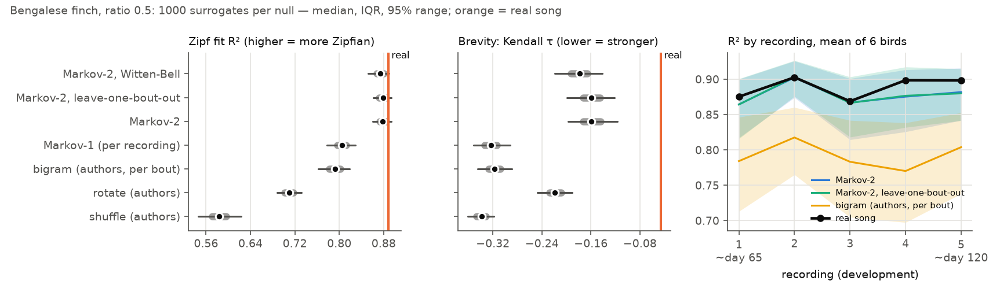

# Bengalese finch: does "structure above the bigram" survive a second-order Markov null?

Reanalysis of Kirby, Okanoya, Garland, Takahasi & Arnon (2026), *Language-like statistical structure arises in
learned signaling: evidence from birdsong*, Sci. Adv. 12(32):eaea3015, doi:10.1126/sciadv.aea3015
(open: PMC13450306). Same pipeline and nulls as the whale analysis in `../README.md`.

**Verdict (2026-10-18, revised 2026-10-25): the finch claim of "sequential structure above the bigram" holds, and
the Zipf fit does not significantly beat a plain order-2 null. Calibrated (§8), it provisionally looks three-back.** The Zipf fit beats the authors' bigram baseline (reproduced, z = 6.7), but it
does not beat an order-2 Markov chain, whether plain or leave-one-bout-out, at any of the three cutting ratios.
It beats a Witten-Bell-smoothed order-2 chain only narrowly, at 2 of 3 ratios. On Kendall τ, brevity is weaker in real song than in
every null; on the authors' Poisson slope, it ties with shuffled song and is weaker than the rest. Against the plain nulls this is the
same pattern as the whale song; the calibration (§8) differs.

**Update (2026-10-25, §8):** calibrated against fake song of known memory, finch song at ratio 0.5 looks
three-back rather than two-back. My fake bouts are more alike than real ones, though, and allowing for that moved
the whale result a lot, so treat this as provisional.

- **Reproduction is exact.**
  - R² 0.889 / 0.751 / 0.899 at ratios 0.5 / 0.3 / 0.7 (paper: 0.89 / 0.75 / 0.90).
  - Cuts per bout 10.719 / 5.01 / 16.746 (paper: 10.72 / 5.01 / 16.75).
  - Brevity β −0.0445 (SE 0.0045) over the same 1043 types (glmer: −0.0447, SE 0.0045).
  - Bigram-baseline z 6.7 / 9.4 / 1.8 (paper: 6.77 / 9.22 / 1.87). Shuffle and rotation z within 1.4 of the paper.
  - The published segmentation is reproduced in 299/299 bouts.
- **Markov-1 per recording ≈ the authors' per-bout bigram baseline** (z 6.6 vs 6.7 at 0.5). So the bigram
  result is robust to how the first-order null is built.
- **Markov-2: real song is not significantly more Zipfian at any ratio.**
  - Plain: z = 1.2, p = 0.12 at 0.5; z = 1.3, p = 0.10 at 0.3; z = −1.5 at 0.7, where the null is *more* Zipfian.
  - Leave-one-bout-out: identical (z = 1.2 / 1.2 / −1.4). Bouts within a recording are so stereotyped that
    holding one out removes nothing.
  - Witten-Bell: real is better at 0.5 (z = 1.6, p = 0.031) and 0.3 (z = 2.5, p = 0.005), but not at 0.7 (z = −2.0).
- **Development does not change the verdict.** At every one of the 5 recordings, mean R² beats bigram and
  Markov-1 (z 2.3–3.5) and is within the Markov-2 null (p 0.17–0.52).
  - Crystallised song (recordings 4–5) edges further above Markov-2 than early song (recordings 1–2):
    z = 1.3 (p = 0.08) vs 0.4 (p = 0.36).
  - Against Witten-Bell, crystallised song is better at p = 0.044 and early song is not (p = 0.11).
  - This trend toward structure beyond the trigram as song matures is not significant against plain Markov-2.
- **Brevity was never tested against a null in the paper.**
  - Kendall τ is −0.045 for real song vs −0.16 to −0.34 for every null (p = 1.000 at ratio 0.5; ≥ 0.81 in all 21 cells).
  - On the authors' own Poisson slope, real (−0.0445) equals shuffled song (−0.0434, p = 0.38) and is shallower
    than every other null (p = 1.000).
- **Power law (CSN, pooled types, ratio 0.5).** α = 1.99 vs Markov-2 2.04 [1.99, 2.09]. The likelihood ratio
  favours a lognormal (R = −4.8, p = 0.0003), as it does in ≥ 97% of samples from every null.



## 1. Data recovery

The paper says all data are in the Supplementary Materials. They are, but only as a table on PDF pages 49–58
of `sciadv.aea3015_sm.pdf`, drawn as **vector glyph outlines with no text layer**: pdftotext and pypdf return
nothing. Fetched from the Europe PMC supplementary-files API (`download/europepmc_suppl.zip`); PMC itself
serves a JS bot check. All downloads were treated as untrusted and read with `python -I`.

`extract_dataset.py` turns each filled path into one glyph and clusters identical outlines (101 shapes, 22,258
glyphs). Each shape was labelled once by eye from `glyph_montage.png` (`glyph_labels.json`). Rows are rebuilt from
the table's cell rectangles, and spaces from the inter-glyph gap. The gaps are cleanly bimodal: ≤ 1.75 pt
within a unit, ≥ 2.75 pt between units.

Integrity checks, all exact:
- 299 bouts, 30 recordings (6 birds × 5 days), with the same bird/day list as the notebook printout.
- 20,289 syllables, so 20,289 − 299 = **19,990 bigrams**, which equals the nobs of their TP model.
- The printed table marks the authors' own ratio-0.5 segmentation with spaces. It gives **10.719063545150501
  cuts per bout**, identical to their notebook printout to all digits.
- My reimplementation reproduces that printed segmentation in **299/299 bouts**.

Result: `finch_bouts.tsv` (bird, day, bout with the published unit boundaries).

## 2. Method

As in the whale analysis (`../pipeline.py`), with the authors' unit. Each recording (bird × day) is one
"song type": TPs are pooled over its 9–10 bouts (bigrams never cross a bout boundary), cuts are made per bout,
and sub-sequence types are counted per recording.
- R² is the mean over 30 recordings of the Pearson r² of log count vs log rank.
- Brevity is a Poisson regression of type frequency on length with per-bird intercepts (authors: glmer with
  `(1|bird)`), plus the mean per-recording Kendall τ.
- Cutting ratios are 0.5 (main), 0.3 and 0.7, as in the paper.

Nulls (`run_finch.py`), 1000 each, all re-run through the identical pipeline:
- **shuffle**: within bout (authors).
- **rotate**: shift cuts within bout (authors).
- **bigram (authors, per bout)**: their `shuffled_data_bigram_based`, reimplemented. Each bout is regenerated
  from *its own* bigram list, starting from a random element of the bout; at a dead end it jumps to a random
  element.
- **Markov-1**: order-1 chain per recording; each bout keeps its length and first element.
- **Markov-2**: order-2 chain per recording; each bout keeps its first two elements.
- **Markov-2, leave-one-bout-out**: each bout is generated from an order-2 chain fitted on the recording's
  *other* bouts, so nothing unique to that bout can be copied.
- **Markov-2, Witten-Bell**: interpolated, smoothed order-2 chain per recording.

Compute ran at verified IDLE priority (0x40), checkpointed every 25 samples.

## 3. Reproduction

| Quantity | Paper / Code S1 | This reimplementation |
|---|---|---|
| Mean R², ratio 0.5 / 0.3 / 0.7 | 0.89 / 0.75 / 0.90 | 0.889 / 0.751 / 0.899 |
| Cuts per bout, 0.5 / 0.3 / 0.7 | 10.719063545150501 / 5.01 / 16.75 | 10.719063545150501 / 5.010 / 16.746 |
| Segmentation at 0.5 vs the published table | — | 299/299 bouts identical |
| Shuffle z, 0.5 / 0.3 / 0.7 | 17.05 / 16.32 / 9.04 | 16.2 / 15.8 / 8.9 |
| Bigram-baseline z, 0.5 / 0.3 / 0.7 | 6.77 / 9.22 / 1.87 (p = 0.031) | 6.7 / 9.4 / 1.8 (p = 0.028) |
| Rotation z, 0.5 / 0.3 / 0.7 | 15.69 / 11.9 / 9.661 | 15.5 / 13.3 / 9.7 |
| Brevity β, Poisson, `(1|bird)` | −0.044662 (SE 0.004514), 1043 types | −0.0445 (SE 0.0045), 1043 types (bird fixed intercepts) |

z-scores vary between runs because they are random. Their seeds are Python's `random`, mine are numpy's.

## 4. Null results (1000 surrogates each)

Rank-frequency R². Each cell gives the null mean, z, and one-sided p(null ≥ real); the paper's z is in brackets.

| Null | ratio 0.5 | ratio 0.3 | ratio 0.7 |
|---|---|---|---|
| **real R²** | **0.889** | **0.751** | **0.899** |
| shuffle (authors) | 0.583, z=16.2, p=0.001 [17.05] | 0.336, z=15.8, p=0.001 [16.32] | 0.817, z=8.9, p=0.001 [9.04] |
| rotate (authors) | 0.710, z=15.5, p=0.001 [15.69] | 0.476, z=13.3, p=0.001 [11.9] | 0.838, z=9.7, p=0.001 [9.661] |
| bigram (authors, per bout) | 0.792, z=6.7, p=0.001 [6.77] | 0.523, z=9.4, p=0.001 [9.22] | 0.881, z=1.8, p=0.028 [1.87] |
| Markov-1 (per recording) | 0.804, z=6.6, p=0.001 | 0.534, z=8.9, p=0.001 | 0.886, z=1.5, p=0.065 |
| **Markov-2** | **0.878, z=1.2, p=0.116** | **0.722, z=1.3, p=0.102** | **0.907, z=−1.5, p=0.926** |
| Markov-2, leave-one-bout-out | 0.878, z=1.2, p=0.113 | 0.724, z=1.2, p=0.101 | 0.907, z=−1.4, p=0.904 |
| Markov-2, Witten-Bell | 0.873, z=1.6, p=0.031 | 0.696, z=2.5, p=0.005 | 0.910, z=−2.0, p=0.961 |

Brevity at ratio 0.5. Here p is the share of nulls at least as steep or strong as real song:

| Null | Kendall τ mean [95%] | p(null τ ≤ real) | Poisson slope mean [95%] | p(null ≤ real) | Types |
|---|---|---|---|---|---|
| **real song** | **−0.045** | | **−0.0445** | | 1043 |
| shuffle (authors) | −0.339 [−0.361, −0.318] | 1.000 | −0.0434 [−0.0512, −0.0360] | 0.380 | 3275 |
| rotate (authors) | −0.218 [−0.247, −0.190] | 1.000 | −0.0671 [−0.0715, −0.0630] | 1.000 | 2335 |
| bigram (authors) | −0.317 [−0.344, −0.289] | 1.000 | −0.1264 [−0.1445, −0.1087] | 1.000 | 1911 |
| Markov-1 | −0.323 [−0.352, −0.291] | 1.000 | −0.1302 [−0.1498, −0.1139] | 1.000 | 1879 |
| Markov-2 | −0.159 [−0.197, −0.117] | 1.000 | −0.0815 [−0.0960, −0.0693] | 1.000 | 1177 |
| Markov-2, leave-one-bout-out | −0.159 [−0.199, −0.121] | 1.000 | −0.0813 [−0.0959, −0.0690] | 1.000 | 1174 |
| Markov-2, Witten-Bell | −0.179 [−0.219, −0.142] | 1.000 | −0.0866 [−0.1012, −0.0732] | 1.000 | 1288 |

## 5. Development (ratio 0.5)

Each cell gives the mean R² over the 6 birds at that recording, then the null mean, z, and p(null ≥ real).
Recording 1 is about day 60–70; recording 5 is about day 120, crystallised song.

| Stage | Real R² | Bigram (authors) | Markov-1 | Markov-2 | Markov-2, leave-one-bout-out | Markov-2, Witten-Bell |
|---|---|---|---|---|---|---|
| rec 1 | 0.875 | 0.784, z=2.6, p=0.002 | 0.791, z=2.5, p=0.002 | 0.864, z=0.5, p=0.334 | 0.864, z=0.5, p=0.338 | 0.854, z=0.9, p=0.194 |
| rec 2 | 0.903 | 0.818, z=3.5, p=0.001 | 0.831, z=3.4, p=0.001 | 0.902, z=0.0, p=0.524 | 0.903, z=−0.0, p=0.529 | 0.892, z=0.7, p=0.258 |
| rec 3 | 0.869 | 0.783, z=2.5, p=0.001 | 0.799, z=2.3, p=0.003 | 0.867, z=0.1, p=0.522 | 0.867, z=0.1, p=0.510 | 0.869, z=−0.0, p=0.541 |
| rec 4 | 0.899 | 0.770, z=3.3, p=0.001 | 0.789, z=3.3, p=0.001 | 0.875, z=1.0, p=0.165 | 0.877, z=1.0, p=0.184 | 0.872, z=1.2, p=0.099 |
| rec 5 | 0.898 | 0.804, z=3.2, p=0.001 | 0.810, z=3.3, p=0.001 | 0.882, z=0.9, p=0.197 | 0.880, z=1.0, p=0.191 | 0.878, z=1.0, p=0.149 |
| early (rec 1–2) | 0.889 | 0.801, z=4.2, p=0.001 | 0.811, z=3.9, p=0.001 | 0.883, z=0.4, p=0.357 | 0.884, z=0.4, p=0.373 | 0.873, z=1.1, p=0.110 |
| crystallised (rec 4–5) | 0.898 | 0.787, z=4.6, p=0.001 | 0.800, z=4.6, p=0.001 | 0.879, z=1.3, p=0.080 | 0.878, z=1.4, p=0.092 | 0.875, z=1.6, p=0.044 |

## 6. Comparison with the whale result (`../README.md`)

| | Humpback whale (Arnon et al. 2025) | Bengalese finch (Kirby et al. 2026) |
|---|---|---|
| Unit / data | year; 55 recordings, 45,749 elements | recording (bird × day); 299 bouts, 20,289 syllables |
| Real R² (main ratio 0.5) | 0.930 | 0.889 |
| vs first-order null | z = 6.0 (Markov-1) | z = 6.7 (authors' bigram), 6.6 (Markov-1) |
| vs Markov-2 | z = −2.1, null more Zipfian | z = 1.2, p = 0.12 |
| vs Markov-2 held out | z = −1.9 (leave-one-recording-out) | z = 1.2, p = 0.11 (leave-one-bout-out) |
| vs Markov-2 Witten-Bell | z = 3.0, p = 0.001 | z = 1.6, p = 0.031 |
| Brevity τ, real vs nulls | −0.25 vs −0.34 to −0.40 | −0.045 vs −0.16 to −0.34 |
| CSN α, real / Markov-2 | 2.01 / 2.02 | 1.99 / 2.04 |

Both songs show the same thing:
- The Zipf fit of TP-segmented chunks beats first-order nulls by a similar margin (z ≈ 6).
- An order-2 null is not significantly beaten, even one that never sees the held-out recording or bout (but see §8
  for the finch).
- It beats only a *smoothed* order-2 chain: clearly for whales, narrowly for finches.
- Brevity is weaker in real song than in random sequences cut by the same rule.

The statistic consistently detects first-order transition structure plus a little more. The calibration in §8 suggests the finch has a
little more (three-back at ratio 0.5), with the caveat given there.

## 7. Caveats

- **The dataset was recovered by glyph clustering, not from a machine-readable file.** It passes four exact
  checks (bout count, bigram nobs, cuts per bout to 15 digits, 299/299 published segmentations). A labelling
  error would have to be one that preserves all of these, which is very unlikely.
- **Bouts within a recording are highly stereotyped,** so leave-one-bout-out is not a capacity control. It is
  identical to plain Markov-2. A leave-one-day-out version (fit on the same bird's other recordings) would be
  stronger, but song changes across development, so it would also confound age. It was not run.
- **The per-recording samples are small** (about 35 sub-sequence types per recording at 0.5). So R² is noisy and
  the per-stage development comparisons have little power: 6 birds per stage.
- **Kendall τ for the real data is close to zero** (−0.045). The authors' Poisson slope is significant
  (z = −9.9), but shuffled song gives the same slope, so it says nothing about the sequential structure.
- **CSN was run on type frequencies pooled over 30 recordings** (a mixture). There was no bootstrap GOF test;
  per-recording samples are too small for one.

## 8. Small-data calibration (2026-10-25)

Same check as the whale (`../README.md`), run by `smalldata_finch.py`. Recordings (bird × day) play the role of
whale years, and bouts the role of whale recordings. Full tables: `results/smalldata_tables.md`.

**Held-out prediction** (bits per syllable, leave-one-bout-out, pooled over 30 recordings): order 0 2.877,
order 1 1.148, order 2 0.732, order 3 0.702, order 4 0.745. Order 3 wins pooled, by 0.03 bits. Per recording it
is split: order 2 is best in 16 recordings, order 3 in 10, order 4 in 4.

**Calibration** (real song's z against bands of 20 fake datasets per chain, Markov-1 / Markov-2):

| Ratio | Real | Order 1 | Order 2 | Order 3 |
|---|---|---|---|---|
| 0.5 (main) | +6.6 / +1.2 | [−1.5, +1.1] / [−1.7, +1.2] | [+4.8, +6.5] / [−1.6, +0.5] | [+6.2, +8.3] / [−0.2, +3.0] |
| 0.3 | +8.9 / +1.3 | [−1.4, +1.0] / [−2.0, +0.5] | [+6.6, +9.7] / [−1.5, +1.4] | [+8.2, +10.8] / [+0.5, +3.1] |
| 0.7 | +1.5 / −1.5 | [−1.7, +0.6] / [−1.7, +0.6] | [+1.0, +3.9] / [−0.8, +2.7] | [+2.2, +4.0] / [−0.2, +2.5] |

- **Ratio 0.5:** real song is above every order-2 dataset on both nulls (2.6 and 2.9 SD above the order-2 mean)
  and inside the order-3 band.
- **Ratio 0.3:** inside both the order-2 and order-3 bands.
- **Ratio 0.7:** nothing fits; real song's Markov-2 z is 3.2 SD below the order-2 mean.
- **The small-data effect is weak here.** A Markov-2 null beats its own order-2 fake song by only 0.4 SD (whale:
  1.5), probably because bouts are stereotyped.

**Caveat.** Real bouts differ from each other more than my fake bouts do: 0.732 vs 0.66–0.70 bits, and 0.9% vs
0.4–0.6% of contexts unseen in the other bouts. For the whale, allowing for such differences changed the picture.
I didn't run a per-bout version here, so "three-back at ratio 0.5" is provisional.

## 9. Files

| File | Role |
|---|---|
| `extract_dataset.py` | glyph-outline extraction → `glyph_montage.png`, `glyphs.json`; with `glyph_labels.json` → `finch_bouts.tsv` |
| `finch_bouts.tsv` | recovered dataset: bird, day, bout (spaces = published units, `/` = line wrap) |
| `run_finch.py` | `real` (reproduction), `null <name>` (1000 surrogates, checkpointed), `summary` (tables, figure) |
| `smalldata_finch.py` | §8: `ce` (held-out order selection), `ncv <1\|2\|3>` (synthetic truths, checkpointed), `het` (between-bout differences), `report`; `python -I smalldata_finch.py` = self-check |
| `results/` | `real.json`, `null_*.json`, `summary.json`, `tables.md`; §8: `smalldata_ce.json`, `smalldata_ncv*.json`, `smalldata_het.json`, `smalldata.json`, `smalldata_tables.md` |
| `download/` | untrusted SM (Europe PMC zip, SM PDF, `sm.txt`); read, never executed |

Shared code: `../pipeline.py`. Its `brevity_slope` gained an optional `groups` argument (bird intercepts); the
whale output is unchanged, which was checked. `../powerlaw.py`, `../lowprio.py`.

Rerun from `whalesong/finch/` (about 25 min at idle priority):

```bash
python -I run_finch.py finch_bouts.tsv real
```

```bash
for n in shuffle rotate bigram_authors markov1 markov2 markov2cv markov2wb; do python -I run_finch.py finch_bouts.tsv null $n 1000; done
```

```bash
python -I run_finch.py finch_bouts.tsv summary > results/tables.md
```

§8 (about 40 min per truth at idle priority; the three `ncv` runs can run in parallel):

```bash
python -I smalldata_finch.py finch_bouts.tsv ce && for t in 1 2 3; do python -I smalldata_finch.py finch_bouts.tsv ncv $t; done && python -I smalldata_finch.py finch_bouts.tsv het && python -I smalldata_finch.py finch_bouts.tsv report
```
